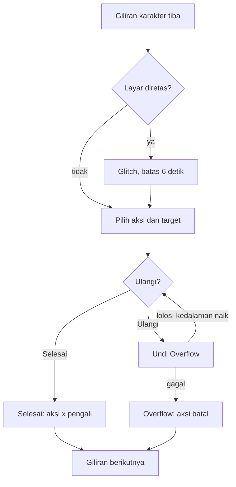

# Recursio | Battle System v1

Diperbarui: 5 November 2026

## Ringkasan

Battle Recursio tetap turn-based dengan Stack sebagai inti: tiap giliran, pemain memutuskan berapa kali mengulang aksi sebelum risikonya meledak. Empat mekanik lain muncul sesuai jenis musuh.

| Mekanik | Muncul saat | Dipakai oleh | Input |
| --- | --- | --- | --- |
| Stack | Semua battle | Nino, Kael, dan musuh | Tap Ulangi atau Selesai |
| Retas Layar | Melawan anomali EM dan bos EM | Musuh | Cari tombol asli, swipe notifikasi |
| Dua Telinga | Semua battle kecuali sekte | Kael | Tap Dengar |
| Race Condition | Battle bos | Nino dan bos | Geser kartu, tap saat lampu hijau |
| Bukti | Battle sekte di Bab 5 | Nino dan Kael | Tap kartu Bukti |

Angka di dokumen ini adalah titik awal untuk tuning lewat simulasi. Aturan yang tidak disebut di sini tetap mengikuti Game System v1.

## Alur satu giliran

Glitch Retas hanya mengganggu sebelum aksi dipilih. Inti tiap giliran adalah loop Ulangi yang berhenti di Selesai atau Overflow. Di battle bos, Balapan terjadi sebelum giliran ini dimulai.

## Stack

Setelah memilih aksi, pemain menumpuknya sebelum dilepas. Tumpukan bisa hilang semua karena Overflow, jadi tiap Ulangi adalah taruhan.

1. Pilih aksi dan target. Kedalaman mulai di 1.
2. Tap Ulangi untuk naik satu kedalaman, atau Selesai untuk melepas aksi.
3. Tiap Ulangi langsung diundi. Lolos berarti pengali naik, gagal berarti Overflow.
4. Selesai menjalankan aksi dengan pengali kedalaman terakhir.

| Kedalaman | Pengali | Peluang Overflow saat naik ke sini |
| --- | --- | --- |
| 1 | x1 | 0 persen |
| 2 | x1,5 | 15 persen |
| 3 | x2,5 | 35 persen |
| 4 | x4 | 60 persen |

- Stack hanya untuk aksi yang menghasilkan angka: Serang, Putus Sinyal, Jangkar, dan kartu Bukti.
- Pengali Stack menggantikan m di rumus damage Game System, lalu dikalikan pengali skill.
- Overflow: aksi batal dan EN tetap terpakai. Overflow di kedalaman 4 juga membuat karakter Hang (melewatkan giliran berikutnya).
- Dengan angka ini, berhenti di kedalaman 2 atau 3 paling menguntungkan rata-rata. Kedalaman 4 hanya layak untuk Sela atau menghabisi musuh.

**Stack musuh dan Sela**

- Di gilirannya, musuh bisa Mengisi alih-alih menyerang. Kedalaman stack-nya naik satu dan tampil di kartunya.
- Musuh melepas serangan saat kedalamannya 3, atau lebih awal sesuai polanya.
- Sela: serangan yang mengenai musuh yang sedang Mengisi meruntuhkan stack-nya jika kedalaman serangan itu sama atau lebih tinggi. Musuh yang runtuh terkena Hang.
- Pola awal: musuh biasa memilih Mengisi dengan peluang 40 persen. Bos punya pola tetap per fase.

## Retas Layar

Anomali EM dan bos EM menyerang perangkat, bukan otak, jadi Nino pun kena. Serangan Retas mengenai satu karakter dan merusak tampilan giliran berikutnya karakter itu.

| Glitch | Efek di layar | Cara melawan |
| --- | --- | --- |
| Tukar | Dua tombol perintah bertukar posisi | Baca label sebelum tap |
| Palsu | Muncul satu tombol palsu yang hampir sama | Tombol palsu bergetar 1 piksel dan tanpa bayangan. Tap tombol palsu berarti giliran hilang |
| Spam | 2 sampai 4 notifikasi menutupi tombol | Swipe tiap notifikasi ke samping |

- Selama layar diretas, giliran dibatasi 6 detik. Waktu habis berarti karakter otomatis Bertahan.
- Batas waktu bisa dimatikan di pengaturan (mode santai).
- Patch (skill Nino, EN 2, tidak bisa di-stack): hapus semua glitch dari layar party dan kebal Retas selama 2 giliran.
- Glitch makin berat per bab: Bab 1 hanya Tukar, Bab 2 tambah Spam, Bab 3 ke atas semua jenis dan bisa bertumpuk.

## Dua Telinga

Bisikan entitas hanya terdengar oleh Kael. Dengan Dengar, pemain melihat rencana musuh, tapi kesadaran Kael yang dibayar.

- Dengar: aksi gratis Kael, sekali per ronde, tidak memakai giliran, biaya Kesadaran 15. Tidak bisa dipakai saat Kael pingsan.
- Efek: ikon aksi berikutnya tiap musuh (Serang, Mengisi, Lepas, Retas, Serbu) beserta targetnya muncul di kartu antrian sampai akhir ronde.
- Tanpa Dengar, kartu musuh hanya menampilkan tanda tanya dan kedalaman stack-nya.
- Tidak berlaku melawan sekte, karena mereka tidak dikendalikan entitas.

Makin rendah kesadaran Kael, makin tidak bisa dipercaya bisikannya.

| Tingkat kesadaran | Tampilan bisikan |
| --- | --- |
| Stabil (51 sampai 100) | Teks jelas, ikon selalu benar |
| Goyah (21 sampai 50) | Teks terdistorsi, ikon tetap benar |
| Kritis (1 sampai 20) | 30 persen ikon palsu, pemain tidak diberi tahu yang mana |
| Diambil alih (0) | Dengar tidak bisa dipakai |

## Race Condition

Hanya di battle bos. Saat kartu Nino dan kartu bos jatuh di slot antrian yang sama, terjadi Balapan dengan lampu start seperti balap motor. Pemenangnya beraksi, aksi yang kalah batal.

1. Tiga lampu merah menyala bergantian, lalu lampu hijau menyala setelah jeda acak 1 sampai 2,5 detik.
2. Pemain tap tombol besar setelah lampu hijau.
3. Tap sebelum hijau berarti false start dan langsung kalah.
4. Tap dalam batas waktu bos berarti menang: Nino beraksi dan aksi bos di slot itu batal.
5. Telat berarti kalah: bos beraksi dan aksi Nino di slot itu batal.

| Pemicu | Siapa | Cara |
| --- | --- | --- |
| Salip | Nino | Skill EN 3, sekali per ronde, dipakai di fase antrian awal ronde tanpa memakai giliran. Geser kartu Nino ke slot kartu bos |
| Serbu | Bos | Di awal ronde, bos memindahkan kartunya ke slot Nino. Terlihat di antrian sebelum ronde berjalan |

Batas waktu reaksi turun per bab: 700 ms (bos Bab 1), 620, 560, 500, lalu 450 ms (bos Bab 5). Angka ini harus diuji di HP sungguhan karena ada jeda sentuh layar.

## Bukti

Pengikut sekte patuh karena iman, bukan karena dikendalikan. Karena itu battle melawan mereka memakai bar Iman 0 sampai 100, bukan HP. Iman habis berarti pengikut Ragu dan berhenti bertarung.

- Petunjuk yang ditemukan saat jelajah Bab 1 sampai 5 menjadi kartu Bukti. Target versi 1: 12 kartu, 4 untuk tiap Keyakinan.
- Tiap kartu Bukti sekali pakai per battle dan memakai satu giliran.
- Tiap pengikut berpegang pada satu dari tiga Keyakinan: Mukjizat, Nabi, atau Keselamatan. Pindai Nino mengungkapnya.
- Bukti yang cocok dengan Keyakinan menurunkan Iman 30, yang tidak cocok hanya 8. Bukti bisa di-stack.
- Overflow saat menumpuk Bukti membuat pengikut makin yakin: Iman naik 10.
- Serang biasa hanya menurunkan Iman 5, karena kekerasan tidak menggoyahkan iman.
- Putus Sinyal tidak bisa dipakai melawan pengikut sekte, karena mereka tidak dikendalikan entitas.
- Pengikut tetap menyerang HP party seperti musuh biasa.
- Bos Pengawal Nabi punya Iman 200 dan dua Keyakinan.

Pemain yang melewatkan petunjuk saat jelajah akan merasakan Bab 5 lebih berat. Jelajah jadi punya taruhan.

## Perubahan ke Game System v1 dan verifikasi

Dokumen ini mengubah enam bagian Game System v1. Perubahan ini sudah diterapkan ke Game System.

| Bagian Game System | Perubahan |
| --- | --- |
| Rumus damage | m diganti pengali Stack dikali pengali skill |
| Skill Nino | Tambah Patch (EN 2) dan Salip (EN 3, hanya battle bos) |
| Skill Kael | Tambah Dengar (gratis, Kesadaran 15) |
| Status | Tambah Hang dan Ragu |
| Musuh sekte | HP diganti Iman: Pengikut Sekte 100, Pengawal Nabi 200 |
| Bar kesadaran Kael | Tambah biaya Dengar 15 |

**Kriteria lulus saat build**

- [x] Simulasi 1.000 battle per bab dengan strategi berhenti di kedalaman 2: menang 70 sampai 90 persen melawan musuh biasa, 50 sampai 70 persen melawan bos. Lulus untuk Bab 1 sampai 4 (`node tools/sim.mjs`), Bab 5 menyusul bersama Bukti.

**Hasil simulasi build (12 November 2026)**

Asumsi simulasi: battle biasa berisi 2 musuh bab itu, bos dilawan sendiri dengan 2 Kopi Kaleng. Party masuk dengan HP penuh, EN 5, kesadaran 100, di level target. Pemain salah tap 10 persen saat layar diretas. Strategi: Stack berhenti di kedalaman 2, musuh yang Mengisi diincar untuk Sela, Kael menyembuhkan sekutu di bawah 40 persen HP, Nino memakai Putus Sinyal saat EN cukup. Dengar dan Balapan belum ikut dihitung.

| Bab | Battle | Menang | Rata-rata ronde |
| --- | --- | --- | --- |
| 1 | Biasa | 78 persen | 6,5 |
| 1 | Bos | 62 persen | 9,0 |
| 2 | Biasa | 79 persen | 8,6 |
| 2 | Bos | 55 persen | 9,0 |
| 3 | Biasa | 86 persen | 7,5 |
| 3 | Bos | 64 persen | 6,6 |
| 4 | Biasa | 80 persen | 6,8 |
| 4 | Bos | 64 persen | 6,2 |

Catatan: battle biasa 6 sampai 9 ronde masih terasa panjang untuk HP. Penyebab utamanya Jangkar (pulih 20 + 2 x level per giliran) yang hampir menutup damage musuh. Kalau battle mau lebih singkat, pilihannya menurunkan Jangkar atau menaikkan biayanya, lalu tuning ulang musuh.
- [ ] Uji Balapan di HP Android kelas menengah: pemain baru menang minimal 80 persen percobaan di bos Bab 1.
- [ ] Tiap jenis glitch Retas dikenali dalam 6 detik oleh 3 penguji baru.
- [ ] Bab 5 bisa dimenangkan dengan minimal 6 dari 12 kartu Bukti.

**Layar battle (build, 12 November 2026)**

- Layar battle ada di `battle/ui.mjs` dan memakai mesin yang sama dengan simulasi. Isinya kartu musuh (HP, kedalaman Stack, rencana jika Dengar), kartu Nino dan Kael (HP, EN, kesadaran), strip antrian, menu perintah, fase Stack (Ulangi dengan peluang Overflow, Selesai), dan glitch Tukar dengan batas 6 detik.
- Untuk uji, ada satu titik anomali di peta (dekat jalan melintang) yang memicu battle melawan 2 Anomali Statis. Menang berarti anomali hilang. Kalah bisa diulang. Ini sementara sampai konten Bab 1 dibuat.
- Dunia 3D berhenti dirender selama battle supaya hemat baterai. Gambar terakhirnya jadi latar.
- Belum ada: glitch Palsu dan Spam (Bab 2 ke atas), Balapan (battle bos), Bukti (Bab 5), dan mode santai tanpa batas waktu.

**Pertanyaan terbuka**

- [x] Equipment yang memberi efek khusus memengaruhi mekanik ini: Overflow Ringan, Waktu Lega, Telinga Tenang, Start Mantap, dan Ulang Sekali. Dirinci di dokumen Equipment.
