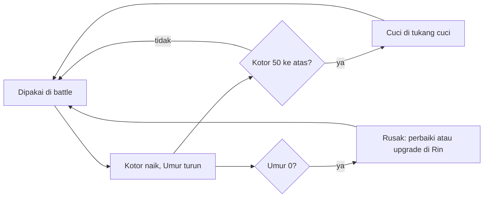

# Recursio | Equipment v1

Diperbarui: 5 November 2026

## Ringkasan dan keputusan

Equipment membuat pemain memilih, bukan sekadar memakai yang paling besar angkanya: tiap item punya sisi plus dan sisi minus, kotor setelah dipakai, aus seiring waktu, dan butuh NPC untuk dicuci, diperbaiki, atau di-upgrade. Angka di dokumen ini adalah titik awal untuk tuning.

| Keputusan | Sumber |
| --- | --- |
| Slot: topi, baju (kaos atau rompi), gelang, sepatu | Renzy |
| Tier: Normal, Rare, Epic, Legendary, Mythical | Renzy (urutan umum) |
| Level equipment (ILv) terpisah dari level pemain | Renzy |
| Tiap item punya plus dan minus, tapi ILv 15 tetap lebih kuat dari ILv 1 | Renzy |
| Item bisa memberi status khusus, makin tinggi tier makin absurd | Renzy |
| Alisa mencuci gratis, Rin memperbaiki dan meng-upgrade, job punya tier | Renzy |
| Aturan umur pakai, cuci, perbaikan, dan upgrade di dokumen ini | Diusulkan, bisa diubah |

## Slot dan aturan plus minus

Tiap karakter punya 4 slot: topi, baju, gelang, sepatu. Item dipakai bergantian oleh siapa saja di party.

Kekuatan item dihitung dengan poin anggaran (PV untuk sisi plus, MV untuk sisi minus). Poin hanya alat desain, pemain hanya melihat angka stat dan efeknya.

```latex
PV = \left\lfloor (4 + 2 \times ILv) \times \text{pengali tier} \right\rfloor
\qquad
MV = \left\lceil PV \times \text{rasio minus} \right\rceil
```

| Pengeluaran | Biaya |
| --- | --- |
| ATK +1 | 5 poin |
| DEF +1 | 5 poin |
| HP +1 | 2 poin |
| SPD +1 | 12 poin (total SPD dari gear dibatasi -3 sampai +3) |
| Efek kecil | 4 poin |
| Efek sedang | 8 poin |
| Efek besar | 14 poin |

- Sisi plus (stat plus dan efek) tidak boleh melebihi PV. Sisa poin dibuang.
- Sisi minus harus minimal MV, dibulatkan ke atas ke satuan stat. Minus boleh di stat apa saja, tapi tidak boleh sekaligus plus dan minus di stat yang sama.
- Bonus bersih (PV dikurangi MV) tetap naik seiring ILv, jadi item ILv tinggi selalu lebih kuat dari ILv rendah.

## Tier

Tier menentukan batas atas, ILv menentukan kekuatan saat ini. Item Mythical di ILv 8 bisa lebih lemah dari item Epic di ILv 11 sampai di-upgrade.

| Tier | Pengali PV | Rasio minus | ILv maksimum | Umur (battle) | Efek yang boleh | Sifat absurd |
| --- | --- | --- | --- | --- | --- | --- |
| Normal | 1,0 | 0,25 | 5 | 40 | Tidak ada | Barang sehari-hari yang seadanya |
| Rare | 1,1 | 0,30 | 8 | 35 | Kecil | Benda remeh dengan sifat aneh |
| Epic | 1,2 | 0,35 | 11 | 30 | Kecil atau sedang | Barang bekas yang seperti punya kemauan sendiri |
| Legendary | 1,3 | 0,40 | 13 | 25 | Sedang atau besar | Barang dengan riwayat, seolah mengingat kemenangan lama |
| Mythical | 1,5 | 0,50 | 15 | 20 (tidak aktif di versi 1) | Besar, ditambah satu Beban unik | Peninggalan yang tidak mau dipaksa |

Bonus bersih di ILv tertinggi tiap tier, dibanding item Normal ILv 1:

| Item | PV | MV | Bonus bersih |
| --- | --- | --- | --- |
| Normal ILv 1 | 6 | 2 | 4 |
| Normal ILv 5 | 14 | 4 | 10 |
| Rare ILv 8 | 22 | 7 | 15 |
| Epic ILv 11 | 31 | 11 | 20 |
| Legendary ILv 13 | 39 | 16 | 23 |
| Mythical ILv 15 | 51 | 26 | 25 |

## Level equipment (ILv)

ILv dipisah dari level pemain dan tidak ada syarat level untuk memakai item. ILv awal item ditentukan tempat ia ditemukan, dan bisa naik lewat upgrade.

| Bab | ILv item yang ditemukan (dibatasi maksimum tier) |
| --- | --- |
| 1 | 1 sampai 3 |
| 2 | 3 sampai 5 |
| 3 | 5 sampai 7 |
| 4 | 7 sampai 9 |
| 5 | 9 sampai 11 |

Upgrade menaikkan ILv satu tingkat, sampai batas yang lebih rendah antara maksimum tier item dan maksimum tier job NPC.

## Efek khusus

Efek memakai anggaran PV dan dibatasi tier. Efek yang memberi status ke musuh tidak berlaku pada bos kecuali disebut.

| Kelas | Efek | Keterangan |
| --- | --- | --- |
| Kecil (4) | Overflow Ringan | Peluang Overflow Stack turun 5 poin persentase di semua kedalaman |
| Kecil (4) | Waktu Lega | Batas waktu Retas Layar bertambah 1 detik |
| Kecil (4) | Telinga Tenang | Biaya Kesadaran skill Dengar turun 3 |
| Sedang (8) | Pancing | Musuh memilih pemakai sebagai target dua kali lebih sering |
| Sedang (8) | Statis | Serangan pemakai menurunkan ATK anomali EM 20 persen selama 2 giliran |
| Sedang (8) | Ngomel Ringan | Serang punya peluang 15 persen membuat musuh biasa melewatkan giliran berikutnya |
| Besar (14) | Start Mantap | Batas waktu Balapan di battle bos bertambah 120 ms |
| Besar (14) | Ngomel | Serang punya peluang 30 persen membuat musuh biasa melewatkan giliran berikutnya, bos kebal |
| Besar (14) | Ulang Sekali | Sekali per battle, satu Overflow dibatalkan dan aksi dilepas di kedalaman sebelumnya |

## Kotor, umur, dan Beban

Tiap item punya dua meter yang dikelola pemain. Semuanya dihitung per battle dan per langkah jelajah, tidak memakai waktu nyata.



**Kotor (0 sampai 100)**

- Naik 5 tiap battle yang diikuti pemakai, 10 tiap battle bos.
- Bonus plus berkurang menurut tingkat Kotor, bonus minus tidak berkurang.

| Kotor | Tingkat | Efek |
| --- | --- | --- |
| 0 sampai 49 | Bersih | Bonus plus penuh |
| 50 sampai 79 | Kotor | Bonus plus x0,75 |
| 80 sampai 99 | Bau | Bonus plus x0,5, pemakai ditarget musuh dua kali lebih sering |
| 100 | Busuk | Bonus plus 0 dan efek khusus mati, minus tetap berlaku |

- Cuci memulihkan Kotor ke 0. Selama dicuci, item tidak ada di tas dan tidak bisa dipakai. Lama cuci dalam langkah jelajah: Normal 100, Rare 150, Epic 200, Legendary 250.

**Umur (dalam battle)**

- Umur maksimum menurut tier: Normal 40, Rare 35, Epic 30, Legendary 25, Mythical 20. Item Mythical tidak aus di versi 1, jadi tidak bisa Rusak.
- Turun 1 tiap battle yang diikuti pemakai, turun 2 jika pemakai pingsan.
- Umur 0 berarti Rusak: stat dan efek mati, dan item tidak bisa dicuci.
- Perbaiki memulihkan Umur ke penuh dan memakan 100 langkah. Bahan: 1 Benang.
- Upgrade menaikkan ILv 1 tingkat, memulihkan Umur ke penuh, dan memakan 200 langkah. Bahan: Kain Perca sebanyak ILv saat ini, ditambah 1 Benang.

**Beban (khusus Mythical)**

- Item Mythical tidak bisa kotor. Sebagai gantinya tiap item Mythical punya satu Beban yang membatasi pemakaian lama.
- Sepatu Nenek Nino memakai Beban Pegal: naik 10 tiap aksi pemakai. Di 100, sepatu terlepas sendiri, pemakai Hang satu giliran, dan sepatu baru bisa dipakai lagi setelah Pegal di bawah 50.
- Pegal turun 1 tiap 2 langkah jelajah selama sepatu tidak dipakai.

## NPC job dan tier job

Job punya tier yang sama dengan item. NPC hanya bisa menangani item yang tier-nya sama atau lebih rendah dari tier job-nya.

| NPC | Job | Tier awal | Naik tier | Biaya |
| --- | --- | --- | --- | --- |
| Alisa | Cuci | Normal | Rare setelah Bab 2, Epic setelah Bab 4 | Gratis |
| Rin | Perbaiki dan Upgrade | Normal | Rare setelah Bab 2, Epic setelah Benang Emas ditemukan di Bab 3 | Bahan (lihat bagian Umur) |
| Tukang Cuci Kampung (placeholder) | Cuci | Legendary | Tidak naik di versi 1 | Gratis |

- Item Mythical tidak butuh cuci. Perbaikan dan upgrade Mythical butuh job tier Mythical, yang ditunda ke luar versi 1.
- Rin meng-upgrade sampai ILv maksimum tier job-nya. Karena itu tier job juga menjadi batas kekuatan upgrade.

## Contoh item

| Item | Slot | Tier | ILv | Plus | Minus | Efek |
| --- | --- | --- | --- | --- | --- | --- |
| Topi Kardus | Topi | Normal | 1 | DEF +1 | HP -1 | Tidak ada |
| Sandal Jepit Putus | Sepatu | Normal | 5 | SPD +1, HP +1 | DEF -1 | Tidak ada |
| Gelang Karet Nasi Kuning | Gelang | Rare | 4 | ATK +1, HP +2 | DEF -1 | Overflow Ringan |
| Rompi Ojek Pangkalan | Baju | Epic | 7 | DEF +2, HP +1 | SPD -1 | Pancing |
| Kaos Juara Balap Tarkam | Baju | Legendary | 8 | ATK +2 | HP -6 | Start Mantap |
| Sepatu Nenek Nino | Sepatu | Mythical | 8 | SPD +1, HP +2 | DEF -3 | Ngomel, Beban Pegal |

Cek anggaran: Rompi Ojek Pangkalan memakai PV 21 (Pancing 8, DEF +2 10, HP +1 2 = 20) dan MV 8 (SPD -1 = 12). Sepatu Nenek Nino memakai PV 30 (Ngomel 14, SPD +1 12, HP +2 4 = 30) dan MV 15 (DEF -3 = 15).

## Asal item dan bahan

- Equipment ditemukan di peti dan objek saat jelajah, atau diberikan NPC sebagai hadiah cerita (misalnya Sepatu Nenek Nino di Bab 5). ILv-nya mengikuti tabel per bab.
- Musuh tidak menjatuhkan equipment. Musuh biasa menjatuhkan satu bahan (Benang atau Kain Perca, acak) dengan peluang 25 persen per battle, dan bos selalu menjatuhkan 1 Kain Perca.
- Tidak ada toko dan uang di versi 1, sesuai PRD. Angka drop adalah titik awal untuk tuning.

## Struktur data

```json
{
  "item": {
    "id": "sepatu_nenek_nino",
    "nama": "Sepatu Nenek Nino",
    "slot": "sepatu",
    "tier": "mythical",
    "ilv": 8,
    "plus": { "spd": 1, "hp": 2 },
    "minus": { "def": 3 },
    "efek": { "id": "ngomel", "kelas": "besar", "peluang": 0.3 },
    "beban": { "id": "pegal", "perAksi": 10, "batas": 100, "pulihPerLangkah": 0.5, "bisaPakaiLagiDi": 50 },
    "umurMaks": 20
  },
  "save": {
    "equip": { "nino": { "topi": null, "baju": null, "gelang": null, "sepatu": "sepatu_nenek_nino" } },
    "itemMiliki": [
      { "id": "sepatu_nenek_nino", "ilv": 8, "kotor": 0, "umur": 20, "beban": 0 }
    ],
    "bahan": { "benang": 0, "kain_perca": 0, "benang_emas": 0 },
    "pekerjaanNpc": [
      { "npc": "rin", "jenis": "upgrade", "itemId": "gelang_karet_nasi_kuning", "sisaLangkah": 120 }
    ]
  }
}
```

## Cakupan bertahap dan perubahan ke dokumen lain

Equipment menambah cakupan versi 1, jadi dibangun bertahap mengikuti bab.

| Bab | Yang aktif |
| --- | --- |
| 1 | 4 slot, tier Normal dan Rare, plus dan minus, efek Rare |
| 2 | Kotor dan cuci (Alisa), Umur dan perbaikan (Rin), bahan Benang dan Kain Perca |
| 3 | Tier Epic, efek sedang, upgrade, Benang Emas |
| 4 | Tier Legendary, efek besar, Tukang Cuci Kampung |
| 5 | Item Mythical pertama, Sepatu Nenek Nino, Beban Pegal |

Perubahan di tabel berikut sudah diterapkan ke PRD dan Game System.

| Dokumen | Perubahan |
| --- | --- |
| PRD | Equipment, cuci, perbaikan, dan upgrade masuk versi 1. Ekonomi uang tetap ditunda. "Inventory kompleks" dipersempit menjadi daftar item dan 4 slot per karakter |
| Game System | Stat gear ditambahkan ke stat dasar. Tambah item bahan. Struktur save menyimpan equip, meter, dan pekerjaan NPC |
| Battle System | Efek equipment mengubah Overflow, batas waktu Retas, biaya Dengar, dan batas waktu Balapan |

**Kriteria lulus saat build**

- [x] Uji otomatis: bonus bersih tiap tier di ILv maksimum lebih besar dari bonus bersih Normal ILv 1, dan tabel bonus bersih naik berurutan antar tier.
- [x] Setiap item di data lulus aturan: sisi plus tidak melebihi PV, sisi minus minimal MV, total SPD dari gear antara -3 dan +3.
- [ ] Simulasi: party yang tidak pernah mencuci menang minimal 10 poin persentase lebih jarang dari party yang rajin mencuci, supaya cuci terasa penting.
- [x] Uji sentuh: mengganti item di satu slot maksimal 3 tap dari menu (Tas, slot, item).
- [ ] Sepatu Nenek Nino: setelah 10 aksi pemakai, Pegal 100, sepatu terlepas, dan pemakai Hang satu giliran.

**Build equipment dasar (13 November 2026)**

- Aktif: 4 slot, tier Normal dan Rare, plus dan minus, efek Overflow Ringan. Data di `battle/data.mjs`, aturan di `game/progress.mjs`, uji di `tools/test-progress.mjs`. Uji ini mencakup dua kriteria di atas untuk tier yang sudah aktif. Tier Epic ke atas diuji saat tiernya masuk.
- Item Bab 1 di data: Topi Kardus, Kaos Oblong Pudar, Sandal Jepit Biru, Gelang Karet Nasi Kuning. Gelang Karet dipasang di ILv 3 (bukan 4 seperti contoh) supaya masuk rentang ILv Bab 1, dengan plus ATK +1, HP +1, Overflow Ringan dan minus DEF -1.
- Sementara keempat item ada di tas sejak awal, sampai peti Bab 1 dibuat.
- Kotor, Umur, cuci, perbaikan, dan bahan menyusul di Bab 2 sesuai tabel cakupan.

**Pertanyaan terbuka**

- [x] Alisa (kakak Nino), Rin (ibu Kael), dan nenek Nino diperkenalkan khusus untuk game dulu, tidak mengikat novel.
- [x] Bahan Benang dan Kain Perca dipertahankan. Bahan hanya ditemukan atau jadi drop, tidak dibuat, dan tidak ada toko.
- [x] Item Mythical tidak aus di versi 1, jadi tidak ada kasus Mythical rusak.
- [x] Asal item: jelajah dan hadiah NPC. Musuh hanya menjatuhkan bahan (lihat Asal item dan bahan).
